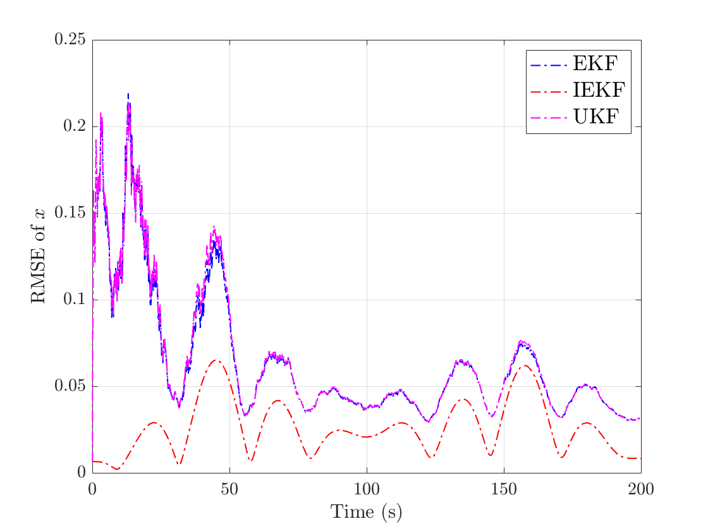
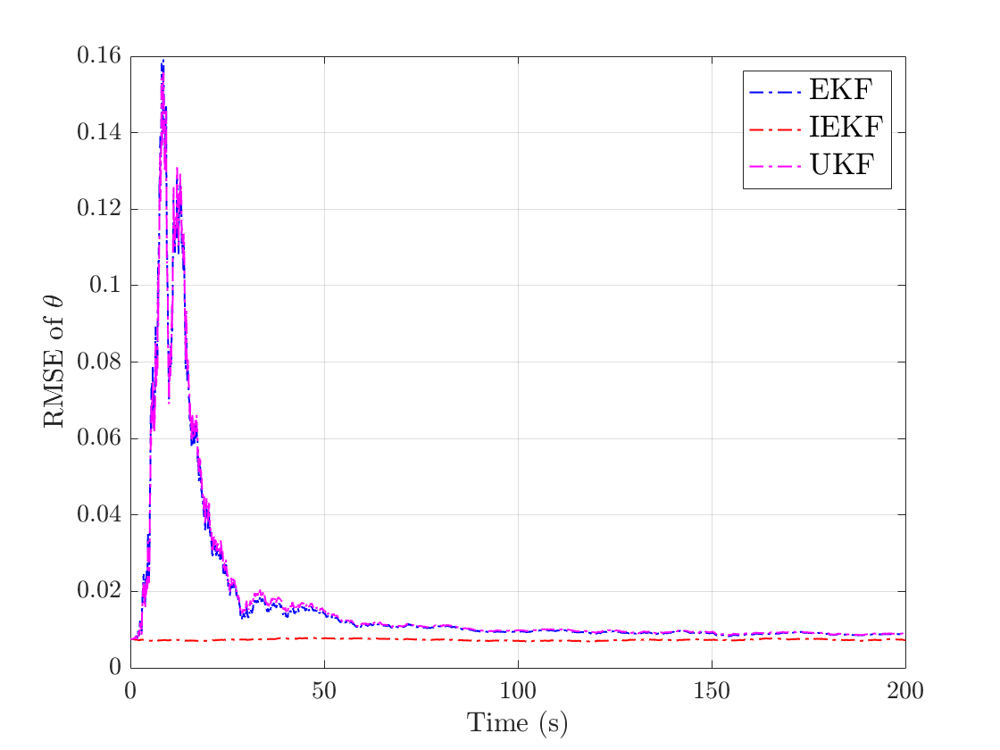
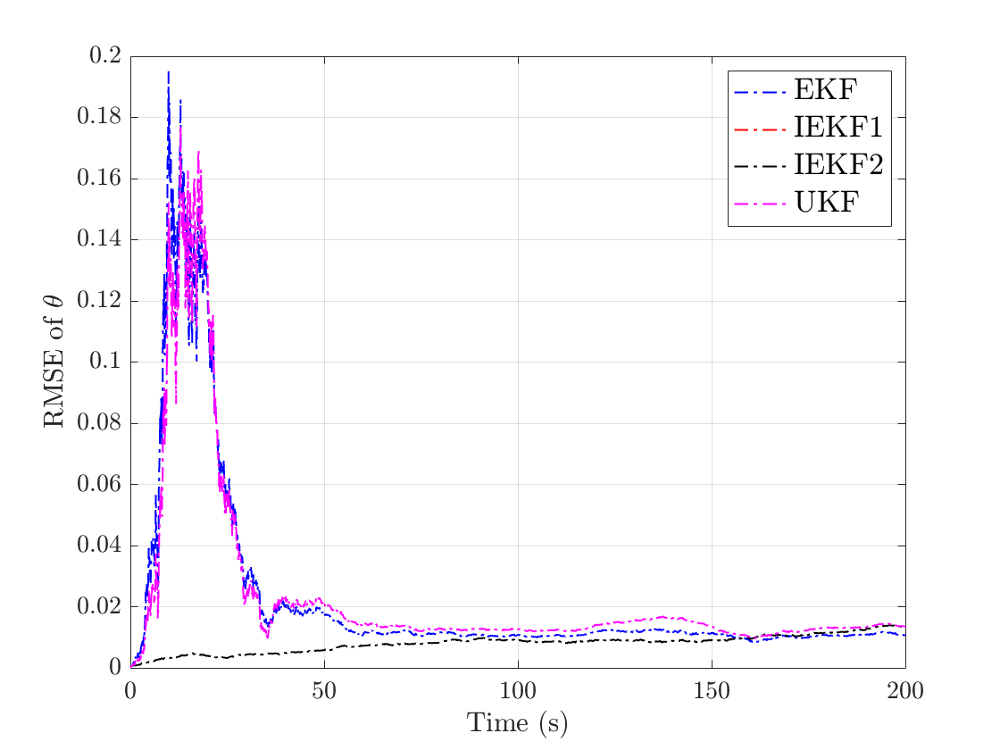
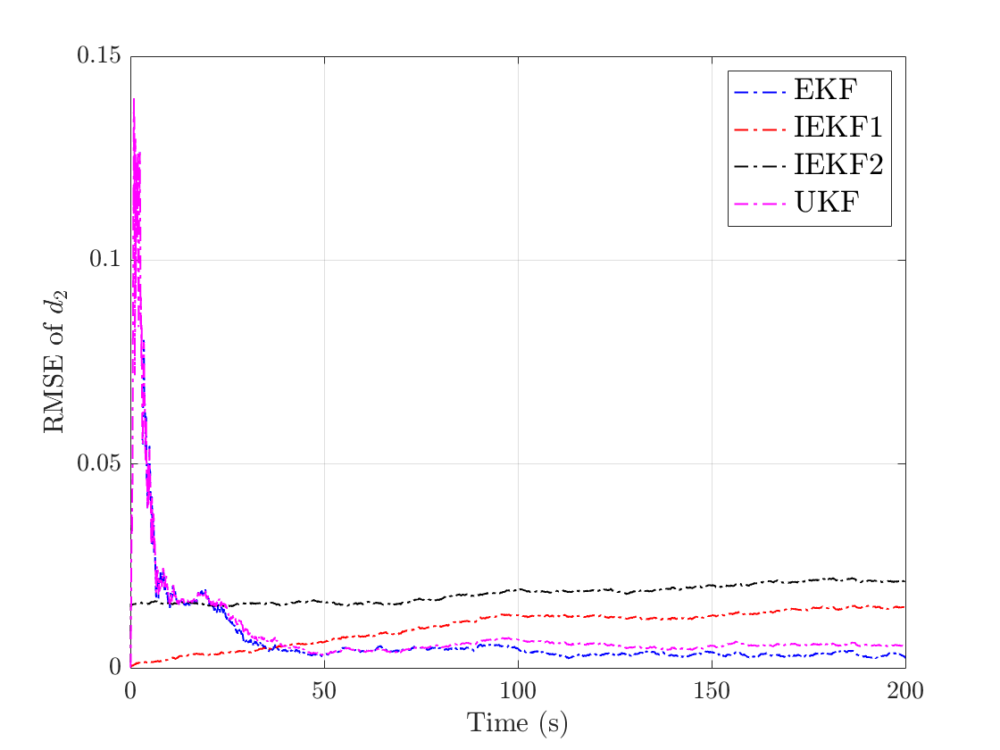

# Invariant EKF

MATLAB implementation of the extended Kalman filter (EKF), the unscented Kalman filter (UKF) and the invariant extended Kalman filter (IEKF) for a unicycle robot, with and without additive disturbances. The code reproduces the examples of Coleman, Bai and Taylor (2021), including their two IEKF designs for joint state and disturbance estimation.

**For an explanation of the method and the results, see the project page:**
**https://mhyoosefian.github.io/projects/invariant-ekf/**

## System

The unicycle has position $(x, y)$, heading $\theta$, linear velocity $v$ and turning rate $\omega$, and is subject to a disturbance $d$:

```math
\dot{x} = v\cos(\theta) + C_x d, \qquad \dot{y} = v\sin(\theta) + C_y d, \qquad \dot{\theta} = \omega, \qquad \dot{d} = A d .
```

Only noisy measurements of the position $(x, y)$ are available.

## Repository structure

```
undisturbed/   example without disturbance (d = 0): EKF, UKF and IEKF
disturbed/     example with a disturbance d in R^4: EKF, UKF, IEKF 1 and IEKF 2
images/        result figures
```

## How to use the code

- **Without disturbance:** run `runMe.m` in the `undisturbed` folder.
- **With disturbance:** run `runMe.m` in the `disturbed` folder.

Each script simulates the system, runs the filters and plots the RMSE of the estimates.

## Results

Without disturbance, the IEKF outperforms the EKF and UKF in terms of estimation RMSE:

 

With disturbance, both IEKF designs avoid the large initial transient of the EKF and UKF, but the EKF and UKF reach slightly lower disturbance errors in the long run, so this example does not exactly match the results of the paper:

 

## Citation

This code is based on the following paper. If you use it in your research work, please cite:

```
@article{coleman2021extended,
  title={Extended invariant-EKF designs for state and additive disturbance estimation},
  author={Coleman, Kevin and Bai, He and Taylor, Clark N},
  journal={Automatica},
  volume={125},
  pages={109464},
  year={2021},
  publisher={Elsevier}
}
```
